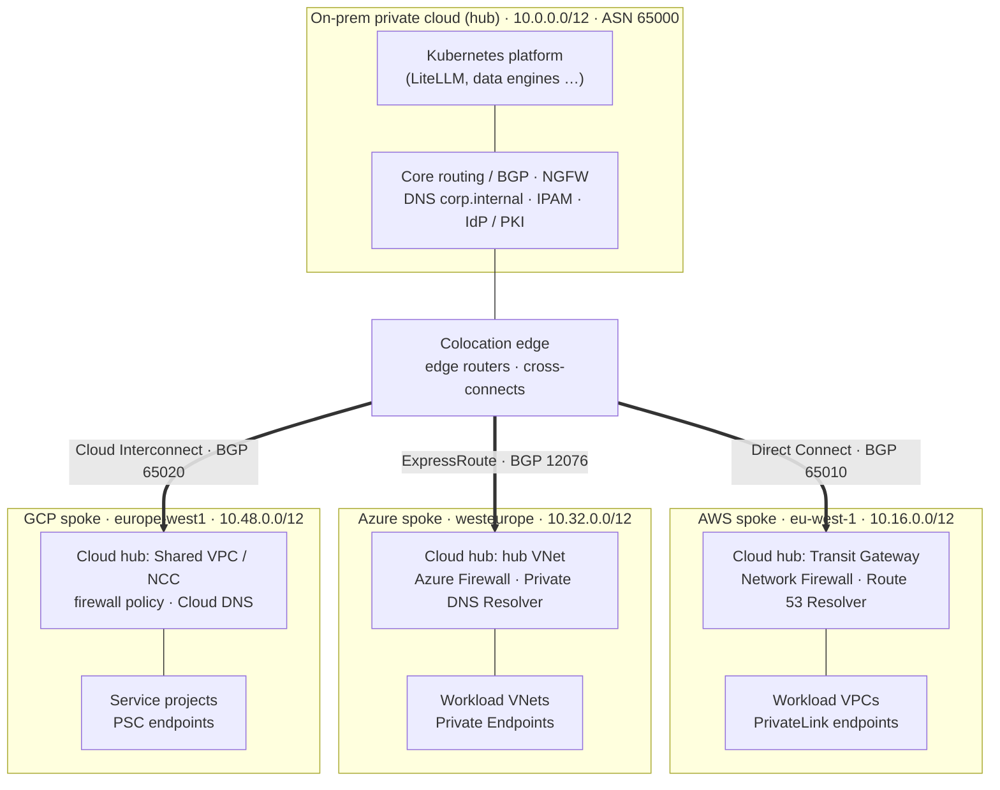

# Hybrid Multi-Cloud (Hub-and-Spoke)

A reference design and Terraform for a **hybrid, multi-cloud** platform. The **on-prem private
cloud is the hub**, and **AWS, Azure and GCP are spokes**. Every link is private and nothing is
exposed publicly:

- **Private circuits only.** Direct Connect, ExpressRoute and Cloud Interconnect; no public internet
  on the data plane.
- **No public exposure.** No public IPs, internet gateways or public PaaS endpoints. Cloud services
  are reached through private endpoints (PrivateLink, Private Endpoint, Private Service Connect),
  and org-level guardrails make every new spoke non-public by default.
- **Two-tier hub-and-spoke.** Tier 1: on-prem ↔ each cloud. Tier 2: inside each cloud, a
  landing-zone **cloud hub** ↔ its **workload spokes**.
- **Hybrid inspection.** A cloud firewall in each cloud hub for east-west traffic; the on-prem NGFW
  for anything touching on-prem. Cross-cloud traffic hairpins through on-prem: there is no direct
  spoke-to-spoke path.
- **Central control.** One routing domain (on-prem ASN `65000`), one private DNS namespace
  (`corp.internal`), one IdP.

A cheap **PoC** runs today on GCP: the home LAN plays on-prem, over an IPsec VPN instead of a
circuit, with a lakehouse and on-prem access to Google's speech and Gemini models.

## High-level schema



Spokes never talk to each other directly: an approved cross-cloud flow goes cloud hub → on-prem
NGFW → other cloud hub, over a dedicated `172.16.0.0/12` cross-cloud address plane. More diagrams
are in the [diagram gallery](docs/diagrams/README.md).

## Cloud comparison

How the same design maps onto each provider. Each cloud's details are in its own folder.

| | [AWS](docs/aws/README.md) | [Azure](docs/azure/README.md) | [GCP](docs/gcp/README.md) |
|---|---|---|---|
| **Region** | `eu-west-1` | `westeurope` | `europe-west1` |
| **Private circuit** | Direct Connect + Transit VIF | ExpressRoute, private peering only | Cloud Interconnect (Dedicated or Partner) |
| **Cloud-side BGP** | TGW `65010` | Microsoft-fixed `12076` | Cloud Router `65020` |
| **Org / tenancy** | Organizations + Control Tower | Management Groups + subscriptions | Organization + folders + projects |
| **Cloud hub** | Network account: Transit Gateway | Connectivity subscription: hub VNet + ER Gateway | Host project: Shared VPC + NCC |
| **Workload spokes** | Accounts, VPCs attached to the TGW | Subscriptions, VNets peered to the hub | Service projects on the Shared VPC |
| **East-west inspection** | AWS Network Firewall | Azure Firewall | Firewall policy / NVA |
| **Private service access** | PrivateLink / VPC endpoints | Private Endpoint / Private Link | Private Service Connect |
| **Private DNS** | Route 53 Resolver + private hosted zones | Private DNS Resolver + Private DNS zones | Cloud DNS forwarding + private zones |
| **Guardrails** | SCPs at OU level | Azure Policy at Management Group | Org Policy at org / folder |
| **Addresses** (private · cross-cloud) | `10.16.0.0/12` · `172.17.0.0/16` | `10.32.0.0/12` · `172.18.0.0/16` | `10.48.0.0/12` · `172.19.0.0/16` |
| **Production fixed cost** (list, per month) | ≈ $1,610 | ≈ $1,900 | ≈ $3,520 (10 Gbps Dedicated Interconnect minimum) |
| **VPN PoC** | Site-to-Site VPN, 2 tunnels, BGP | Route-based VPN Gateway, static routes | HA VPN + Cloud Router, BGP |
| **Status in this repo** | Terraform written, not deployed | Terraform written (no policy code yet), not deployed | **PoCs running**: VPN, hub-and-spoke, lakehouse, speech and Gemini |

The platform totals about **$12.7k a month** with the colo edge and 10 TB of cross-site traffic
([cost estimate](docs/architecture/07-cost-estimate.md)); the GCP VPN PoC costs about $50 a month.

## Documentation

| Folder | Contents |
|--------|----------|
| [`docs/architecture/`](docs/README.md) | The shared, cloud-neutral design: specification, network, connectivity, security, DNS, buildout runbook, cost |
| [`docs/aws/`](docs/aws/README.md) | AWS landing zone, Direct Connect build, SCPs, cost, VPN PoC |
| [`docs/azure/`](docs/azure/README.md) | Azure landing zone, ExpressRoute build, Azure Policy, cost, VPN PoC |
| [`docs/gcp/`](docs/gcp/README.md) | The running GCP hub-and-spoke (VPN, lakehouse, speech and Gemini, live diagram) as one architecture, the hybrid on-prem/GCP AI inference design, and the production landing zone |
| [`docs/diagrams/`](docs/diagrams/README.md) | Diagram gallery |
| [`infra/`](infra/README.md) | Terraform: hub and spoke modules per cloud, guardrail policies, stacks, Makefile, CI |

- **Start with the design:** [docs/README.md](docs/README.md), the reading order.
- **Build it:** [buildout runbook](docs/architecture/06-buildout-runbook.md).
- **Try it cheaply:** [GCP VPN PoC](docs/gcp/hub-connectivity.md), LAN as on-prem over site-to-site VPN.

## Locked decisions

| # | Decision | Choice |
|---|----------|--------|
| D1 | Circuit topology | Dedicated circuits per provider (the PoC uses VPN instead) |
| D2 | Inspection placement | Hybrid (cloud firewalls + on-prem NGFW) |
| D3 | Region scope | Single region per cloud |
| D4 | In-cloud hubs | AWS TGW · Azure hub VNet · GCP Shared VPC/NCC |

Two items are still open: the controlled-egress model and when to add dual POPs
([spec §7.1](docs/architecture/01-architecture-specification.md#71-still-open)).

## Quick start (offline checks)

```bash
cd infra
make fmt validate     # format + validate all stacks (no cloud credentials needed)
```

Then per cloud: fill `stacks/<cloud>/terraform.tfvars` (from `.example`) and `backend.tf`, deploy
`policy/` first, then `terraform apply` the stack. The runbook gives the order and the gates.
