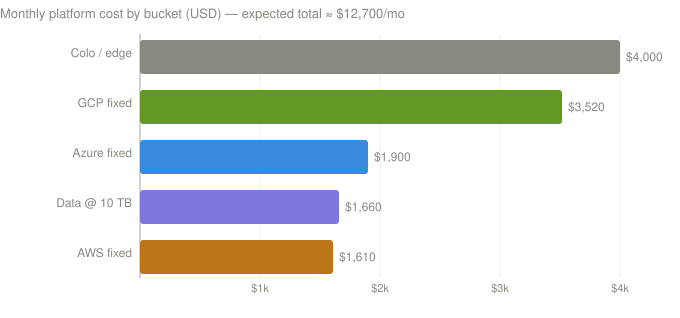

# Cost Estimate

**Status:** Draft v0.1 — illustrative, list-price planning figures
**Basis:** EU regions (eu-west-1 / westeurope / europe-west1), ~730 hrs/month, single region per cloud (D3), dual-circuit redundancy (D1).

> ⚠️ **These are rough planning numbers, not a quote.** Cloud list prices change, vary by region,
> and drop with committed-use / enterprise agreements. Figures exclude **workload** compute, storage,
> and databases (app-specific and usually the largest line), on-prem hardware **capex**, and staff
> cost. Validate against each provider's calculator before budgeting. Currency: USD/month.

---

## 1. What's in scope

The **platform + connectivity** layer that this architecture adds on top of whatever workloads run:
private circuits, in-cloud hubs (transit/gateway), firewalls, DNS resolvers, private endpoints, and
the colocation edge. Data-transfer is shown separately because it scales with traffic.

---

## 2. Fixed monthly cost (per cloud)

### 2.1 AWS

Fixed subtotal **≈ $1,610/month**; line items in [AWS — cost](../aws/README.md#cost).

### 2.2 Azure

Fixed subtotal **≈ $1,900/month**; line items in [Azure — cost](../azure/README.md#cost).

### 2.3 GCP

Fixed subtotal **≈ $3,520/month**; line items in [GCP — cost](../gcp/landing-zone.md#cost). GCP is the
highest because Dedicated Interconnect's smallest port is 10 Gbps; Partner Interconnect is the
biggest saving ([§6](#6-biggest-levers-how-to-reduce)).

---

## 3. Colocation & edge (shared, not per-cloud)

| Item | Monthly |
|------|---------|
| Colo space — 2 diverse cabinets/POPs (~$1,000 each) | $2,000 |
| Cross-connects — 6 × ~$250 | $1,500 |
| Edge routers (capex amortized, indicative) | ~$500 |
| **Colo/edge subtotal** | **≈ $4,000** |

---

## 4. Data transfer (variable — example at 10 TB/month cross-site)

| Item | Rate | At 10 TB | Notes |
|------|------|----------|-------|
| AWS Direct Connect data out | $0.02/GB | $200 | Far cheaper than Internet egress |
| AWS TGW data processing | $0.02/GB | $200 | Per GB through TGW |
| AWS Network Firewall processing | $0.065/GB | $650 | Inspected traffic |
| Azure ExpressRoute egress (metered) | ~$0.025/GB | $250 | Unlimited plan removes this (higher port fee) |
| Azure Firewall processing | $0.016/GB | $160 | |
| GCP Interconnect egress | $0.02/GB | $200 | |
| **Data subtotal @ 10 TB** | | **≈ $1,660** | Scales ~linearly with volume |

Firewall/transit **processing** fees mean **east-west volume matters** — cross-cloud flows that
hairpin through on-prem ([02 §4](02-network-design.md)) get processed by two cloud firewalls **and**
the on-prem NGFW, so they incur processing at each hop.

---

## 5. Roll-up

| Bucket | Monthly | Annual |
|--------|---------|--------|
| AWS fixed | $1,610 | $19.3k |
| Azure fixed | $1,900 | $22.8k |
| GCP fixed | $3,520 | $42.2k |
| Colo / edge | $4,000 | $48.0k |
| Data transfer @ 10 TB | $1,660 | $19.9k |
| **Total (expected)** | **≈ $12,700/mo** | **≈ $152k/yr** |

### Scenario range

| Scenario | Drivers | Monthly |
|----------|---------|---------|
| **Low** | GCP **Partner** Interconnect (1 Gbps), 1 colo cabinet, ~2 TB data | **≈ $7–8k** |
| **Expected** | As tabulated above (10 Gbps GCP dedicated, dual colo, 10 TB) | **≈ $12.7k** |
| **High** | 10 Gbps dedicated all clouds, unlimited ER plan, ~50 TB data | **≈ $20–25k** |

---

## 6. Biggest levers (how to reduce)

1. **GCP: use Partner Interconnect** instead of Dedicated if <10 Gbps — the single largest saving.
2. **Right-size circuits.** Start at 1 Gbps; scale ports when monitored utilization justifies it.
3. **Commit/EA discounts.** AWS/Azure/GCP enterprise agreements and committed-use cut list prices materially.
4. **Keep east-west volume deliberate.** Each inspected GB is billed at multiple hops; avoid chatty
   cross-cloud traffic, co-locate dependent services in one cloud where possible.
5. **Metered vs. unlimited ExpressRoute.** High egress → unlimited plan; low egress → metered.
6. **Consolidate endpoints.** Each interface/private endpoint per-AZ has an hourly fee; share via the
   shared-services spoke rather than duplicating per workload spoke.

---

## 7. Excluded (budget separately)

- Workload compute / storage / managed databases (usually the dominant cost).
- On-prem datacenter hardware, power, and the private-cloud platform itself.
- SIEM/log ingestion volume, backup/DR, and egress for backups.
- Staff / managed-service / support-plan costs.
