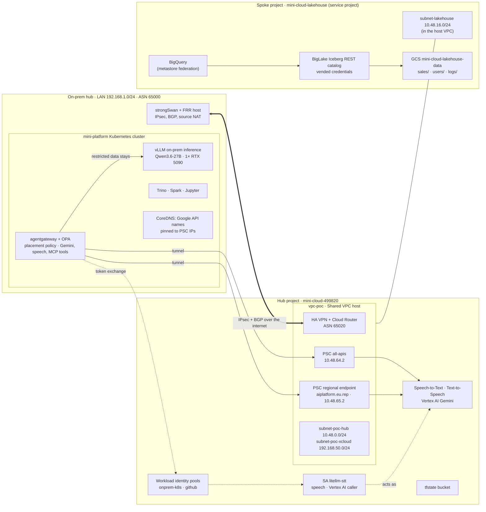

# GCP — One Hub-and-Spoke Platform

Every GCP use case in this repo runs on **one hub-and-spoke**:
- The home LAN plays the on-prem hub.
- One GCP **hub project** holds the network, the tunnel, the private endpoints to Google APIs and
  the identities.
- **Spoke projects** hold workloads and data.

Each use case uses the hub's shared pieces instead of building its own, so a new one is mostly a
spoke or a few hub resources.

**Status:** deployed and running in `europe-west1`, from one Terraform stack,
[`infra/stacks/gcp-poc`](../../infra/stacks/gcp-poc), with its state in GCS. The production target
(Cloud Interconnect, folders, NCC) is designed in [landing-zone.md](landing-zone.md).

← [Project overview](../../README.md) · [Shared design](../README.md) · [AWS](../aws/README.md) · [Azure](../azure/README.md) · GCP

---

## Architecture



- **Solid arrows** are data paths and **dotted arrows** are identity.
- **On-prem engines:** Trino, Spark and Jupyter on the cluster don't use the lakehouse yet. They
  could, over the same tunnel and PSC endpoint, as described in [Adding a use case](#adding-a-use-case).
- **Live diagram:** a generated view of what is actually deployed is in
  [live-diagram.md](live-diagram.md).

---

## Hub and spoke

| | Hub project `mini-cloud-499820` | Spoke project `mini-cloud-lakehouse` |
|---|---|---|
| Role | Connectivity and shared services; the only project with a route to on-prem | Workload and data; no network of its own |
| Network | `vpc-poc`, Shared VPC **host** | Shared VPC **service project**, uses `subnet-lakehouse` of the host |
| Holds | HA VPN, Cloud Router, PSC endpoints, firewall rules, identity pools, the speech SA, Terraform state | GCS bucket, Iceberg catalog and namespaces |
| Location rule | Org list (`europe-west1`) plus `eu`, for the speech and Gemini models | Org list only |
| Module | [`gcp-vpn-poc`](../../infra/modules/gcp-vpn-poc), [`gcp-stt-poc`](../../infra/modules/gcp-stt-poc) | [`gcp-poc-spoke-sharedvpc`](../../infra/modules/gcp-poc-spoke-sharedvpc) |

With no organization, the spoke can instead peer its own VPC with the hub (`spoke_mode = "peering"`,
module [`gcp-poc-spoke`](../../infra/modules/gcp-poc-spoke)). The running setup uses Shared VPC,
which is the production model.

### Network

| Range | Name | Where | Purpose |
|-------|------|-------|---------|
| `10.48.0.0/24` | `subnet-poc-hub` | hub | Hub workloads and test VMs (private plane) |
| `192.168.50.0/24` | `subnet-poc-xcloud` | hub | Cross-cloud plane (PoC stand-in for `172.19.0.0/16`) |
| `10.48.16.0/24` | `subnet-lakehouse` | hub VPC, shared to the spoke | Spoke workloads |
| `10.48.64.2/32` | PSC `all-apis` | hub | Every `*.googleapis.com` API |
| `10.48.65.0/28` | `subnet-poc-psc-endpoints` | hub | Regional PSC endpoints; `10.48.65.2` = `aiplatform.eu.rep` |
| `169.254.0.0/30` | BGP link | tunnel | Cloud Router `.1`, on-prem `.2` |

- **Advertised to on-prem:** the Cloud Router advertises every subnet of `vpc-poc` plus `10.48.64.2/32`
  (`CUSTOM` mode, `ALL_SUBNETS`); on-prem advertises `192.168.1.0/24`.
- **Firewall:** two ingress rules, `allow-from-onprem` (ICMP and TCP 22/80/443 from the LAN) and
  `allow-iap-ssh` (TCP 22 from Google's IAP range).
- **Public IPs:** nothing has a public IP except the two tunnel endpoints.

---

## Shared services

These hub pieces serve every use case. A new use case should reuse them rather than add its own.

| Service | What it gives | Built in |
|---------|---------------|----------|
| **Tunnel** | IPsec + BGP between the LAN and `vpc-poc`; spokes reachable through the hub | [hub-connectivity.md](hub-connectivity.md) |
| **Private Google APIs** | `all-apis` PSC endpoint for `*.googleapis.com`, plus a regional endpoint for two-level names such as `aiplatform.eu.rep.googleapis.com`; GCP VMs use Private Google Access | [ai-inference.md](ai-inference.md#pieces) |
| **Private DNS (on-prem)** | `scripts/gcp-psc-dns.sh` in mini-platform-deployment pins the Google API names used on-prem to the PSC IPs in cluster DNS | [ai-inference.md](ai-inference.md#bring-up) |
| **Keyless identity** | Workload identity federation: pool `onprem-k8s` trusts one Kubernetes service account; pool `github` lets the CI plan and live-diagram jobs act as `tf-plan-ci` and `tf-diagram-ci`. No use case holds a service-account key. | [ai-inference.md](ai-inference.md#how-the-keyless-login-works), [live-diagram.md](live-diagram.md) |
| **Guardrails** | Org policies from [`infra/policy/gcp`](../../infra/policy/gcp): no external IPs, region lock, storage public-access prevention, no default network | [landing-zone.md](landing-zone.md#guardrails) |
| **Quota project** | Cross-project callers bill API usage to the project they name in `x-goog-user-project`, which needs `serviceusage.serviceUsageConsumer` | [spoke-lakehouse.md](spoke-lakehouse.md#cross-project-callers--the-quota-project) |
| **State and diagram** | GCS state bucket in the hub; the CI plan job and the live diagram read it keylessly | [live-diagram.md](live-diagram.md) |

---

## Use cases

| Use case | Sits in | Uses | Doc |
|----------|---------|------|-----|
| **Hybrid connectivity**: the LAN as on-prem hub over IPsec + BGP | hub | (it is the foundation) | [hub-connectivity.md](hub-connectivity.md) |
| **Lakehouse**: GCS data lake + Iceberg REST catalog, BigQuery through federation | spoke | Shared VPC subnet, guardrails, quota project | [spoke-lakehouse.md](spoke-lakehouse.md) |
| **AI inference**: one gateway (agentgateway, with OPA deciding each request) in front of on-prem vLLM, Google's Gemini and speech models (Gemini chat, Chirp 3, Cloud TTS, Gemini TTS, Gemini Live) and the cluster's MCP tools, placed by data class (running) and chosen by benchmark (design) | on-prem + hub (APIs, SA, endpoints) | Tunnel, both PSC endpoints, on-prem DNS, `onprem-k8s` pool, `eu` location exception | [ai-inference.md](ai-inference.md) |
| **Live diagram**: SVG of the deployed resources, regenerated on every change | tooling | State bucket, `github` pool | [live-diagram.md](live-diagram.md) |

How traffic moves for each:

```
connectivity  LAN host ⇄ ipsec0 ⇄ HA VPN ⇄ vpc-poc subnets (hub and spoke)
lakehouse     feeder SA (hub) → GCS managed folder / Iceberg catalog commit   (spoke project)
              engine → Iceberg REST catalog → vended token → GCS              (spoke project)
              BigQuery → BigLake metastore → same tables                      (spoke project)
AI (GCP)      agentgateway pod → CoreDNS → 10.48.64.2 or 10.48.65.2 → tunnel → PSC → Google API
              (identity: pod token → STS → litellm-stt token, no key)
AI (routing)  app → agentgateway (key → project) → OPA (project → data class) → on-prem vLLM, or (internal/public only) → PSC → Vertex AI
diagram       GitHub Actions → github pool → read state bucket → commit SVG
```

### Adding a use case

1. **Decide where it lives.**
   - Data and workloads go in a **spoke**: a new service project on the Shared VPC, with its own
     subnet from `10.48.0.0/12`.
   - Only endpoints and identities everyone shares go in the hub.
2. **Reach Google APIs through the PSC endpoints.**
   - A name under `*.googleapis.com` already works through `all-apis`. On-prem, add the name to
     `gcp-psc-dns.sh`.
   - A two-level name (`*.<region>.rep.googleapis.com`) needs a regional endpoint in
     `subnet-poc-psc-endpoints`, via `psc_rep_endpoints` in the stack.
3. **Give on-prem callers a keyless identity.**
   - Add a provider or an attribute condition to `onprem-k8s` for their Kubernetes service account.
   - Bind them to a service account with only the roles they need.
4. **Check the location.** The org allows `europe-west1` only. A multi-region API needs a
   project-level exception like the hub's `eu` one.

For example, on-prem Trino reading the lakehouse would need:
- a Trino Iceberg catalog pointing at the BigLake REST endpoint;
- `biglake.googleapis.com` and `storage.googleapis.com` pinned to `10.48.64.2`;
- a federated identity with `biglake.viewer` on the spoke.

None of that is deployed yet.

---

## Cost

List prices, running. The fixed part is the hub; everything else is pay-per-use.

| Item | Use case | Monthly |
|------|----------|---------|
| HA VPN tunnel (1) | connectivity | ≈ $36.50 |
| PSC `all-apis` endpoint | shared | ≈ $7.30 |
| PSC regional endpoint (`aiplatform.eu.rep`) | speech/Gemini | ≈ $7.30 + per-GB processing |
| Cloud Router, HA VPN gateway, Shared VPC, identity pools, org policies | shared | $0 |
| Test VMs (off by default) | connectivity | $0 (≈ $8 each when on) |
| GCS storage + catalog calls (sample tables) | lakehouse | cents |
| Speech, TTS and Gemini calls | speech/Gemini | per use, see [ai-inference.md](ai-inference.md#cost) |
| Egress back over the tunnel | all | internet egress rates; ≈ $0 at test volume |
| **Fixed total** | | **≈ $51** |

`terraform destroy` on the stack stops all of it. The production circuit design is about
$3,520 a month for GCP ([landing-zone.md](landing-zone.md#cost)).

---

## Bring-up order

| Step | What | Where |
|------|------|-------|
| 1 | Org guardrails (optional, needs an organization) | [`infra/policy/gcp`](../../infra/policy/gcp) |
| 2 | Hub network and tunnel | `infra/stacks/gcp-poc`, base variables: [hub-connectivity.md §5](hub-connectivity.md#5-build-steps) |
| 3 | On-prem strongSwan + FRR; check BGP | [hub-connectivity.md §6](hub-connectivity.md#6-verification) |
| 4 | Spoke: `enable_spoke = true`, `spoke_mode = "shared_vpc"` | [hub-connectivity.md §6.1](hub-connectivity.md#61-gcp-hub-and-spoke-optional) |
| 5 | Lakehouse: comes with the spoke (`enable_lakehouse` defaults to `true`), then `make seed-lakehouse` | [spoke-lakehouse.md §5](spoke-lakehouse.md#5-deploy-order) |
| 6 | AI inference, GCP tier: `enable_stt` defaults to `true` (so step 2 already builds it), then cluster DNS and the gateway's models | [ai-inference.md](ai-inference.md#bring-up) |

Steps 4–6 are toggles on the same stack; set `enable_stt = false` for a network-only first apply. `make apply-poc` applies it and refreshes the
live diagram.

---

## From PoC to production

| PoC | Production ([landing-zone.md](landing-zone.md)) |
|-----|------------------------------|
| IPsec VPN, one tunnel | Dedicated Interconnect, two VLAN attachments, BFD |
| One hub project, one spoke project | Hub host project + service projects per environment, under folders |
| Cross-cloud plane `192.168.50.0/24` | `172.19.0.0/16` |
| Cluster DNS pins API names | Cloud DNS forwarding with on-prem resolvers (`gcp.corp.internal`) |
| Firewall rules in the VPC | Firewall policy / NVA in the host VPC for east-west |

The routing (BGP `65000 ↔ 65020`), the addresses (`10.48.0.0/12`), Shared VPC, PSC, workload identity
federation and the org policies stay the same.
