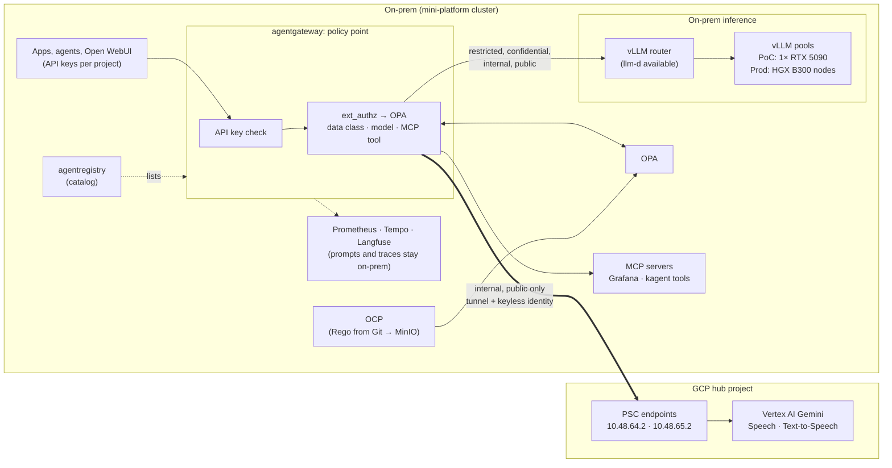

# AI Inference — On-Prem and GCP Behind One Gateway

← [GCP hub-and-spoke](README.md) · [Connectivity](hub-connectivity.md) · [Lakehouse](spoke-lakehouse.md) · [AI inference](ai-inference.md) · [Live diagram](live-diagram.md)

> **Where this sits:** spans the on-prem hub and the GCP hub of the [GCP hub-and-spoke](README.md).
> On GCP it uses the hub project `mini-cloud-499820`: the PSC endpoints, the `onprem-k8s` identity
> pool and the `litellm-stt` SA, reached over the [tunnel](hub-connectivity.md). On-prem it uses the
> mini-platform cluster's vLLM and its gateway, agentgateway, with OPA deciding each request.

On-prem applications chat, transcribe, speak and call shared tools through **one gateway**, the
[mini-platform](https://github.com/nolimitkun/mini-platform-deployment) cluster's
**[agentgateway](https://agentgateway.dev)**. It serves every chat model on one OpenAI-compatible
endpoint, passes Google's speech APIs through with a keyless login, and merges the cluster's MCP
servers into one tool endpoint. Before routing, it asks **OPA** whether the caller's project may use this
model or tool. The policy is Rego in Git; the **OPA Control Plane (OCP)** builds it into bundles that
OPA loads. **agentregistry** is the catalog of tools and agents. agentgateway replaced LiteLLM in
November 2026; the deploy repo's [`docs/agentgateway.md`][agw] covers its configuration.

Behind the gateway sit two tiers:
- **On-prem inference:** vLLM on the cluster's GPU, for work that can't leave the building
  (personal data, regulated records, source code, anything under contract or residency rules).
- **GCP inference:** Google's speech and Gemini models on Vertex AI, reached over the VPN through
  private endpoints with no key.

The gateway decides where each request may run, from the data's class, not from the caller's
preference. Where both tiers are allowed, the project's routing rule picks the model for `auto`
(cheapest, fastest, by prompt type, or fixed); the benchmark below informs those rules.

**Status:**
- **Running:** both tiers, behind agentgateway. vLLM serves Qwen3.6-27B on one RTX 5090, with a
  measured benchmark in mini-platform-deployment. The Gemini chat models and Google's speech APIs
  go over the VPN.
- **Running:** the placement policy in OPA: data class per project, placement per model, per-tool
  rules for MCP, with tests in CI. Per project also: model selection for `auto` (with the vLLM
  Semantic Router for prompt type), rate limits and a spend budget, and a filtered model list
  ([design record][mpp]).
- **Designed, not built:** inward-only fallback, a PII guardrail, the egress controls and the hybrid
  benchmark; see [Plan](#plan).

---

## Architecture



The gateway is the only path to either tier. Everything else hangs off that:
- Callers never get an engine URL or a Google credential (in the PoC the namespace still leaks the gateway's identity; see [Egress](#egress-making-the-gateway-the-only-door)).
- Every API key belongs to a project (`projects/<id>.yaml` in the deploy repo); the key carries
  `{project, key_id}`, and OPA maps the project to a data class. A project can hold several keys.
- Each model, and each Google API, has one placement: `onprem`, `gcp` or `external`.
- A project gets only the placements its class allows. Anything not allowed is denied with a 403 that
  gives the reason.

---

## Models

What agentgateway serves today. Clients send the model name to
`/v1/chat/completions` on `http://agentgateway-proxy.mini-platform.svc.cluster.local/v1`
(`agentgateway.test` from outside the cluster).

**On-prem:**

| Model | Model | Where | Placement |
|-------|-------|-------|-----------|
| `qwen3.6-27b` | Qwen3.6-27B, NVFP4 | vLLM on the cluster's RTX 5090 | `onprem` |

**On GCP**, all in the hub project, chat on the OpenAI endpoint:

| Model | Google model | API, location | Placement |
|-------|--------------|---------------|-----------|
| `gemini-4-argon` | Gemini 4 Argon | Vertex AI, `eu` multi-region | `gcp` |
| `gemini-3.8-flash` | Gemini 3.8 Flash | Vertex AI, `eu` multi-region | `gcp` |
| `gemini-3.5-flash` | Gemini 3.5 Flash | Vertex AI, `eu` multi-region | `gcp` |
| `gemini-3.5-flash-lite` | Gemini 3.5 Flash-Lite | Vertex AI, `eu` multi-region | `gcp` |

**Speech, on GCP, through Google's own APIs.** agentgateway doesn't translate OpenAI `/v1/audio`
calls the way LiteLLM did. Clients call Google's API under a gateway prefix, and the gateway adds the
Google token:

| Gateway route | Google API | Models |
|---------------|------------|--------|
| `/google/speech/...` | Speech-to-Text v2, `eu-speech.googleapis.com` | Chirp 3 (`chirp_3`, location `eu`) |
| `/google/tts/...` | Text-to-Speech v1, `eu-texttospeech.googleapis.com` | Chirp 3 HD voices |
| `/google/vertex-eu/...` | Vertex AI, `aiplatform.eu.rep.googleapis.com` | Gemini 3.8 Flash TTS and Flash-Lite TTS (`generateContent` with audio output) |
| `/google/vertex-europe-west1/...` | Vertex AI, `europe-west1-aiplatform.googleapis.com` | Gemini Live 2.5 Flash native audio (`BidiGenerateContent` websocket) |

All four have placement `gcp`.

**Outside both tiers:** `deepseek-v4-pro` (chat) goes to `api.deepseek.com` over the internet with an
API key. It is neither on-prem nor in the EU, so its placement is `external`: public data only, plus
named exceptions. kagent and HolmesGPT have one, for cluster state and telemetry.

**Tools.** Grafana MCP and kagent's tool server sit behind the gateway as one MCP endpoint at `/mcp`.
OPA decides which project may call which tool. agentregistry lists that endpoint.

How each GCP call travels:

```
client (Open WebUI, kagent, curl …) with its gateway API key
  → agentgateway   POST /v1/chat/completions  model=gemini-4-argon
       API key → project → OPA: class internal, placement gcp → allow
       pod token ──STS──▶ short-lived token for litellm-stt@  (no key file)
  → aiplatform.eu.rep.googleapis.com  (cluster DNS → 10.48.65.2, regional PSC endpoint)
  → IPsec tunnel → Vertex AI generateContent, location eu

client → agentgateway   POST /google/speech/v2/projects/mini-cloud-499820/locations/eu/recognizers/_:recognize
  → eu-speech.googleapis.com   (cluster DNS → 10.48.64.2, PSC endpoint for Google APIs)
  → Speech-to-Text v2, model chirp_3

client → agentgateway   POST /google/tts/v1/text:synthesize
  → eu-texttospeech.googleapis.com  → same DNS, tunnel and PSC endpoint

client → agentgateway   POST /google/vertex-eu/v1/projects/…/locations/eu/publishers/google/models/gemini-3.8-flash-tts:generateContent
  → aiplatform.eu.rep.googleapis.com → regional PSC endpoint

client ⇄ agentgateway   WS /google/vertex-europe-west1/ws/google.cloud.aiplatform.v1.LlmBidiService/BidiGenerateContent
  ⇄ europe-west1-aiplatform.googleapis.com  (cluster DNS → 10.48.64.2)
```

---

## Data classes and placement

| Class | Examples | On-prem | GCP | Notes |
|-------|----------|---------|-----|-------|
| **Restricted** | Personal data under special rules, health, credentials, regulated records, customer source code | ✅ only | ❌ | Never routed or failed over to GCP |
| **Confidential** | Internal financials, unreleased product data, contracts | ✅ default | ⚠️ by exception | Exception needs a named owner and Vertex AI's data terms checked for the use case |
| **Internal** | Internal docs, tickets, code of internal tools | ✅ | ✅ | Place by benchmark: quality, latency, cost |
| **Public** | Published content, marketing, public docs | ✅ | ✅ | Usually the cheapest model that passes the quality bar |

Rules that hold in every class:

- **Fail closed, and fail over only inward.** A GCP model may fall back to on-prem; an on-prem model
  never falls back to GCP. When on-prem is saturated, a restricted request queues or fails; it
  never spills over.
- **Residency.** GCP models run in `eu` or `europe-west1` only, as today. That is already enforced
  by the org's location policy plus the hub's `eu` exception.
- **Logs stay on-prem.** The gateway's traces go to Tempo, the clients' own traces to Langfuse, and
  OPA's decision log to Loki (with request bodies and API keys masked), all on-prem. Restricted
  prompts never leave, even as telemetry.

### How the gateway enforces it

agentgateway calls OPA (the Envoy ext_authz protocol, over gRPC) before routing every request, with
the request body and the key's project and key id. OPA's answer is final; if OPA is down, the gateway denies
everything.

| Mechanism | Where | Effect |
|-----------|-------|--------|
| **Keys per project** | `projects/<id>.yaml` lists key ids; Vault → agentgateway `apiKeyAuthentication`, each entry carrying `{"project": ..., "key_id": ...}` | No key, 401. A key id its project doesn't list, 403, so dropping an id revokes the key. |
| **Data class per project** | `projects/<id>.yaml`: `data_class`, optional `placement` and `models.allow` that only narrow it; classes in `policies/gateway/data.json` | `restricted` and `confidential` → `onprem`; `internal` → `onprem`, `gcp`; `public` → also `external` |
| **Placement per model and Google API** | `catalog/models.yaml`, generated into the bundle as `data.catalog` | A model or API without a placement is denied, so a new model is blocked until someone places it |
| **Named exceptions** | `projects/_exceptions.yaml`, each with an owner and a reason | Today: kagent and HolmesGPT may use `deepseek-v4-pro` |
| **MCP tools per project** | `projects/<id>.yaml`: `mcp_tools`, glob patterns on prefixed tool names | `tools/call` of a tool outside the patterns gets a 403 |
| **Model for `auto`** | `projects/<id>.yaml`: `routing`; `policies/gateway/select.rego` | The gateway asks OPA which model `auto` means for the project, always one it may use |
| **Limits and budget** | `projects/<id>.yaml`: `limits`, `budget`; a rate-limit service with Redis | 429 once the project passes its requests per minute or 30-day spend |
| **Policy delivery** | OCP builds `policies/gateway` from `main` into a bundle in MinIO; OPA polls it | A merged policy change is live within about a minute, with no redeploy. The bundle's manifest names the Git commit. |
| **Tests** | `policies/gateway/authz_test.rego`, `opa test` in CI | Every rule above has a test |

A denied call gets a 403 that says why, for example
`{"error":{"message":"model deepseek-v4-pro is not allowed for project open-webui (internal data)","type":"policy_denied"}}`.

Not built yet, from the original design:
- **Inward-only fallback.** agentgateway's virtual models (`failover`) can send a Gemini request to
  `qwen3.6-27b` when GCP fails. Nothing is set up yet.
- **PII guardrail on cloud-bound calls.** agentgateway has prompt guards (regex, a webhook, Model
  Armor). None is set up yet.
- **Role aliases** (`chat-default`, `chat-sensitive`): virtual models again. The `auto` model,
  chosen per project by OPA, covers part of this.

### Egress: making the gateway the only door

Policy in the gateway only counts if nothing can go around it.

| Layer | PoC today | Production |
|-------|-----------|------------|
| **Google identity** | Google accepts only the gateway's service account, `system:serviceaccount:mini-platform:agentgateway-proxy` (identity-pool condition). But on the Kubernetes side, anything that can create pods in `mini-platform` (Argo CD, JupyterHub's `hub`, the Spark operator) or mint that service account's token (kagent's kmcp controller) can act as it ([who can act as `litellm-stt`](#who-can-act-as-litellm-stt)) | The gateway alone in its own namespace, with the condition updated to match; an admission policy that admits `serviceAccountName: agentgateway-proxy` only for the gateway's pods; no role other than the kubelet's can create `serviceaccounts/token` for it |
| **Network to the PSC IPs** | Any pod can reach `10.48.64.2` over the tunnel. Minikube's CNI doesn't enforce NetworkPolicy, and the tunnel host rewrites every source to its LAN address. | NetworkPolicy egress (a policy-enforcing CNI) lets only the gateway reach the PSC IPs; the on-prem NGFW allows only the gateway's source range to the GCP endpoint ranges |
| **Other projects through PSC** | `all-apis` reaches any project's APIs, so a pod holding its own Google credential could use them | A VPC Service Controls perimeter around the hub, with the PSC endpoint on the `vpc-sc` bundle |
| **Internet** | The home router allows it | Default-deny egress (constraint C2); public AI APIs blocked at the NGFW |

So in the PoC the gateway is not yet the only door. A Spark job, a notebook spawned by JupyterHub,
or a compromised kagent controller can obtain the `agentgateway-proxy` token, trade it for the hub's
Google credentials and call Gemini directly: no data-class check. Without that token, a
pod that reaches the PSC IP can't call anything. Locking down the gateway identity (plan step 3)
closes the main hole and fits the PoC; the network controls in the right-hand column close the
rest in production.

---

## On-prem tier

| | PoC (running) | Production |
|---|---|---|
| Hardware | 1× RTX 5090, 32 GB | HGX B300 nodes: Blackwell Ultra, 288 GB HBM3e per GPU, NVLink within a node |
| Model today | `unsloth/Qwen3.6-27B-NVFP4` (≈ 24 GB of weights), 8k context, FP8 KV cache | Large open-weight models (hundreds of billions of parameters, MoE) at FP8 or NVFP4, long context |
| Engine | vLLM, `--enforce-eager` (no room for CUDA graphs at this weight-to-memory ratio) | vLLM with CUDA graphs, tensor and expert parallelism across a node |
| Routing | agentgateway → vLLM production-stack router (llm-d available, off) | llm-d: prefix-cache-aware scheduling, prefill/decode disaggregation, many replicas |
| Measured | 324.8 output tok/s at concurrency 32; TTFT median 145 ms at concurrency 1 ([benchmark][bench]) | To be measured on the target nodes |

The PoC proves the serving stack, the gateway policy and the benchmark harness. **It doesn't predict
B300 numbers.** The PoC card holds one quantized mid-size model with almost no KV-cache room and
runs in eager mode. The earlier router benchmark also showed that llm-d's value only appears with
several replicas, which only the production cluster has. Treat the PoC as a functional and
methodology test, and re-run the same harness on B300 before deciding placements.

---

## GCP tier

The running path for every Google model: private endpoints, keyless login and a narrowly scoped
service account. The same pattern serves any Google model added later.

### Pieces

| Where | What | Why |
|-------|------|-----|
| `gcp-vpn-poc` | `google_compute_global_address` + `google_compute_global_forwarding_rule` (`all-apis`) at **10.48.64.2** | A private IP for every `*.googleapis.com` API inside the hub VPC. Private Google Access only serves VMs; hybrid clients need this endpoint. The IP comes from the GCP private-endpoint block (doc 02 §1.3). |
| `gcp-vpn-poc` | Cloud Router advertises `10.48.64.2/32` (mode becomes `CUSTOM` + `ALL_SUBNETS`) | So FRR on-prem learns a route to it over `ipsec0`. |
| `gcp-vpn-poc` | Subnet `subnet-poc-psc-endpoints` (**10.48.65.0/28**) + `google_network_connectivity_regional_endpoint` `psc-aiplatform-eu` at **10.48.65.2**, target `aiplatform.eu.rep.googleapis.com` | Vertex AI's `eu` multi-region is a two-level `*.eu.rep.googleapis.com` name, which the `all-apis` endpoint's `*.googleapis.com` certificate doesn't cover. A regional endpoint does; `ALL_SUBNETS` advertises its subnet. |
| `gcp-stt-poc` | `speech`, `texttospeech`, `aiplatform`, `sts`, `iamcredentials` APIs; SA `litellm-stt` with `speech.client`, `serviceUsageConsumer` and custom role `litellmVertexCaller` | The SA can only transcribe, synthesize and call Gemini models (`aiplatform.endpoints.predict`; `roles/aiplatform.user` would also let it create and delete Vertex resources). Text-to-Speech has no IAM permission of its own; a caller that bills the hub as quota project (`x-goog-user-project`) needs `serviceUsageConsumer`. The SA and role keep their LiteLLM-era names: renaming recreates them. |
| `gcp-stt-poc` | Project-level `gcp.resourceLocations` policy: inherit the org's list, add `eu` | The org allows only `europe-west1`, where Chirp 3 and the Gemini 3.8 TTS models don't run. The exception covers the hub only; without it Google answers `FAILED_PRECONDITION … violates constraint`. Gemini Live runs in `europe-west1`, which the org already allows. |
| `gcp-stt-poc` | Workload identity pool `onprem-k8s`, OIDC provider `minikube` | Trusts the cluster's service-account tokens. Its issuer (`https://kubernetes.default.svc.cluster.local`) isn't reachable from Google, so the public keys are uploaded (`onprem-k8s-jwks.json`). The attribute condition accepts only the subjects in `k8s_subjects`: `system:serviceaccount:mini-platform:agentgateway-proxy`. |
| `gcp-stt-poc` | `roles/iam.workloadIdentityUser` on `litellm-stt` for each of those subjects | Lets the gateway's proxy pod impersonate the SA. |
| on-prem host | nftables source rewrite in `ipsec-xfrm.sh` | Without it, traffic into the tunnel leaves as `169.254.0.2`, which GCP can't reply to. |
| mini-platform-deployment | `agentgateway-config` chart: the Gemini models, the `/google/*` routes, `AgentgatewayParameters` with the projected token and credential config; `scripts/gcp-psc-dns.sh` | The client side: token, credential config and DNS. |

### Google APIs

All in the hub project (`mini-cloud-499820`). The `gcp-stt-poc` module enables the first six, with
`disable_on_destroy = false`, so removing the module leaves them on.

| API | Enabled by | Used for |
|-----|------------|----------|
| `speech.googleapis.com` | `gcp-stt-poc` | Speech-to-Text v2 `recognize`, model `chirp_3`, location `eu` |
| `texttospeech.googleapis.com` | `gcp-stt-poc` | Text-to-Speech `text:synthesize`, called on the `eu-texttospeech` endpoint |
| `aiplatform.googleapis.com` | `gcp-stt-poc` | Gemini chat and TTS (`generateContent`, `eu`) and Gemini Live (`BidiGenerateContent`, `europe-west1`) |
| `sts.googleapis.com` | `gcp-stt-poc` | Trades the pod's Kubernetes token for a federated Google token |
| `iamcredentials.googleapis.com` | `gcp-stt-poc` | Trades that for a one-hour token for `litellm-stt` |
| `iam.googleapis.com` | `gcp-stt-poc`, `infra/ci/setup-plan-identity.sh` | The pool, provider and SA; the CI plan job bills the hub, so it needs this to read them |
| `compute.googleapis.com` | already on, **not managed by Terraform** | PSC endpoints, Cloud VPN, Cloud Router |
| `networkconnectivity.googleapis.com` | already on, **not managed by Terraform** | The regional PSC endpoint |
| `orgpolicy.googleapis.com` | already on, **not managed by Terraform** | The `eu` location exception |

The last three predate this work. A fresh hub project needs them enabled by hand before the first
apply. No billing API (`cloudbilling`, `billingbudgets`) is enabled; budgets and billing export
aren't set up.

### How the keyless login works

It's the same federation as the GitHub workflows ([live diagram](live-diagram.md)), with Kubernetes as the identity
provider:

1. The kubelet mounts a service-account token into the gateway's proxy pod, at
   `/var/run/secrets/gcp-wif/token`, minted for the pool's audience and rotated before it expires.
2. The credential config (`type: external_account`, terraform output `stt_credential_config`,
   pointed to by `GOOGLE_APPLICATION_CREDENTIALS`) tells the proxy to send that token to
   `sts.googleapis.com`. GCP checks the signature against the uploaded keys and the subject against
   the condition.
3. The proxy trades the federated token at `iamcredentials.googleapis.com` for a one-hour access
   token for `litellm-stt`, and calls Vertex AI or the speech API with it.

The credential config holds no secret, which is why it can live in Git.

### IAM

Everything below was read back from the hub project and the cluster on 2026-11-05.

#### Identities

| Identity | Where | Part in the flow |
|----------|-------|------------------|
| `system:serviceaccount:mini-platform:agentgateway-proxy` | Kubernetes service account, created by the agentgateway controller for the `agentgateway-proxy` Gateway | What the gateway's proxy runs as. Its projected token is the only credential on-prem. |
| Pool `onprem-k8s`, provider `minikube` | Workload identity federation, hub project | Trusts tokens signed by the uploaded cluster keys, issuer `https://kubernetes.default.svc.cluster.local`. Mapping `google.subject = assertion.sub`; condition `assertion.sub in [...]` over `k8s_subjects`. No `allowedAudiences`, so the token's audience must be the provider's own name (which the projected volume requests). |
| `litellm-stt@mini-cloud-499820.iam.gserviceaccount.com` | Google service account, hub project | The identity every Google call runs as. **No user-managed keys** (0); it is only ever impersonated. |
| Gateway API keys | Vault `mini-platform/agentgateway-api-keys`, one per key id in a project file | Who may call the gateway on-prem. Google never sees them. OPA limits each project to some models and tools. |

#### What `litellm-stt` may do

Its only roles, all on the hub project:

| Role | Permissions | Used by |
|------|-------------|---------|
| `roles/speech.client` | 13: `speech.recognizers.recognize`, `speech.adaptations.execute`, `speech.operations.wait`, and get/list on recognizers, phrase sets, custom classes, operations, locations. No create, update or delete. | `chirp-3` |
| `projects/mini-cloud-499820/roles/litellmVertexCaller` (custom) | `aiplatform.endpoints.predict` only | Gemini chat and TTS (`generateContent`) and Gemini Live (`BidiGenerateContent`); any Gemini model added later needs nothing more. `roles/aiplatform.user` would add creating and deleting Vertex resources. |
| `roles/serviceusage.serviceUsageConsumer` | `serviceusage.services.use` (and read) | For callers that send `x-goog-user-project`, billing the hub as quota project. Text-to-Speech needs nothing more: it has no permission of its own. |

It can't read storage, BigQuery or secrets, can't change IAM, and can't create Vertex endpoints,
recognizers or any other resource.

#### Who can act as `litellm-stt`

On the Google side, two checks must both pass:

1. **The provider's attribute condition** rejects any token whose subject isn't in `k8s_subjects`
   (`rejected by the attribute condition`).
2. **The service account's own policy** has one `roles/iam.workloadIdentityUser` binding per
   subject, for example
   `principal://iam.googleapis.com/projects/311800512343/locations/global/workloadIdentityPools/onprem-k8s/subject/system:serviceaccount:mini-platform:agentgateway-proxy`.

Hub project owners (your user and the `automation` service account) can also impersonate it, as
owners can any service account in the project.

On the Kubernetes side, Google trusts anything holding a valid `agentgateway-proxy` token.
Kubernetes has no permission for "run as this service account": whoever can create pods in
`mini-platform` can start one as `agentgateway-proxy`. The list below was checked with
`kubectl auth can-i` for the LiteLLM-era account in the same namespace, and holds for any account
there:

| Who | Can get the gateway's token by |
|-----|--------------------------------|
| The kubelet | Mounting it into the gateway's proxy pods |
| Argo CD application controller | Creating pods (it deploys the namespace) |
| JupyterHub `hub` | Creating pods (it spawns user servers) |
| Spark operator `spark-operator-controller` and `spark-operator-spark` | Creating pods, so a Spark job's driver can start one |
| kagent `kagent-kmcp-controller-manager` | Requesting a token directly (`serviceaccounts/token` in the namespace) |
| Cluster admins | Anything |

So user code that runs through Spark, or a compromised JupyterHub or kagent controller, could call
the speech APIs as `litellm-stt`. That's limited to transcribing, synthesizing and calling Gemini,
billed to the hub. Ways to narrow it, none applied yet:
- Move the gateway to its own namespace and update the attribute condition.
- An admission policy that admits `serviceAccountName: agentgateway-proxy` only for the gateway's
  pods.
- Drop `serviceaccounts/token` from kmcp's namespace role.

#### Lifetimes and revocation

- **Token lifetimes:** the projected Kubernetes token lives one hour and the kubelet rotates it.
  The federated token and the impersonated access token also last one hour.
- **Revoking:** the two controls stop different steps, so use both.
  - **Removing the `workloadIdentityUser` binding** stops any new `litellm-stt` access token.
    Tokens already issued keep working until they expire, at most an hour.
  - **Disabling the provider** (or the pool) only stops new token exchanges at STS. A federated
    token issued before that still mints `litellm-stt` tokens through the binding until it
    expires. A caller could take a fresh one-hour token just before then, keeping access for up to
    about two hours.
- **Recreated cluster:** new signing keys mean every exchange fails with `invalid_grant` until
  `infra/onprem/refresh-k8s-jwks.sh` uploads them.

#### Related controls

- **Location policy:** a project-level `gcp.resourceLocations` policy on the hub inherits the org's
  `europe-west1` list and adds `eu`. Other projects keep the org lock.
- **CI plan job:** the GitHub Actions identity (`infra/ci/setup-plan-identity.sh`) holds
  `roles/viewer`, `roles/iam.securityReviewer` and `roles/serviceusage.serviceUsageConsumer` on the
  hub. With those it plans these resources, IAM policies and the custom role included, but can't
  change them.
- **Applies:** an owner runs them today. The roles below are enough, without owner.

#### Deployer roles (least privilege)

The roles needed to build the speech services from scratch in a single existing project. That
means the identity pool, `litellm-stt`, the APIs and, for the private path, the VPN and PSC
endpoints. No `owner` or `editor`. Each role was checked with `gcloud iam roles describe` against
the resources Terraform creates.

**Always needed**, on the project:

| Role | Creates |
|------|---------|
| `roles/serviceusage.serviceUsageAdmin` | Turns on `speech`, `texttospeech`, `aiplatform`, `sts`, `iamcredentials`, `iam` (plus `compute` and `networkconnectivity` for the private path). Also lets Terraform bill the project as quota project. |
| `roles/iam.serviceAccountAdmin` | `litellm-stt` and its `workloadIdentityUser` bindings, one per subject |
| `roles/iam.workloadIdentityPoolAdmin` | Pool `onprem-k8s` and provider `minikube`; later JWKS uploads (`refresh-k8s-jwks.sh`) |
| `roles/iam.roleAdmin` | The custom role `litellmVertexCaller` |
| `roles/resourcemanager.projectIamAdmin`, **with the condition below** | The three project-level grants to `litellm-stt`, and nothing else |

```
api.getAttribute('iam.googleapis.com/modifiedGrantsByRole', [])
  .hasOnly(['roles/speech.client',
            'roles/serviceusage.serviceUsageConsumer',
            'projects/PROJECT_ID/roles/litellmVertexCaller'])
```

Without the condition, `projectIamAdmin` could grant any role to anyone. Leaving out
`roles/iam.roleAdmin` means giving `litellm-stt` the predefined `roles/aiplatform.user` instead of
the custom role, which also lets it create and delete Vertex resources.

**Private path only** (VPN and PSC endpoints):

| Role | Creates |
|------|---------|
| `roles/compute.networkAdmin` | VPC and subnets, HA VPN gateway, peer gateway, tunnel, Cloud Router and BGP peer, the `all-apis` PSC endpoint (with its Service Directory namespace), the regional endpoint for `aiplatform.eu.rep.googleapis.com` |

Without the VPN, the gateway calls the same APIs over the internet with the same keyless login, and
this role isn't needed. `roles/compute.securityAdmin` isn't needed either: PSC endpoints need no
firewall rules.

**Terraform state.** If the state lives in a bucket of the project, someone creates the bucket
once (`roles/storage.admin`). After that the deployer needs only `roles/storage.objectUser` on that
bucket. Local state needs no role.

**Location exception.** Chirp 3 and the Gemini 3.8 TTS models run only in `us`, `eu` or `global`.
If an org policy restricts locations, as this org's `europe-west1` lock does, the project needs a
`gcp.resourceLocations` exception adding `eu`. The `gcp-stt-poc` module manages it
(`google_org_policy_policy.allow_eu`) unless told otherwise. Writing it, and even refreshing it,
needs org-policy permissions:
- **Terraform manages it (default, `stt_manage_location_policy = true`):** the deployer also needs
  `roles/orgpolicy.policyAdmin`. It can only be granted at org or folder level, and it covers every
  org policy.
- **An org admin owns it (least privilege):** set `stt_manage_location_policy = false`. The
  exception is then outside Terraform's state, so the deployer needs no org-policy permission, not
  even read access. The org admin creates it once (or skips it if no location policy applies).

To hand an existing exception over, take it out of state first. Run this in
`infra/stacks/gcp-poc` with the credentials you apply with: the state is shared, in the GCS bucket.
The address ends in `allow_eu` before the first apply with the `moved` block and in `allow_eu[0]`
after it, so look it up:

```bash
terraform state list | grep allow_eu
terraform state rm '<the address printed above>'
```

Then set `stt_manage_location_policy = false`. Setting the variable without `state rm` makes the next
apply **delete** the exception.

**Not needed:**
- `owner` or `editor`
- any Speech or Text-to-Speech admin role (Text-to-Speech has no permission of its own)
- `aiplatform.admin`
- `iam.serviceAccountTokenCreator`: on-prem logs in through the pool, not through the deployer

In this repo the speech services sit in the hub project (`mini-cloud-499820`), and the same roles
cover them there. The hub's other resources (firewall rules, Shared VPC, the lakehouse spoke) need
more, outside this doc. To prove the list, run a from-scratch apply into a fresh project with a
service account holding exactly these roles: a 403 names any missing permission.

### More GCP models: options

| Option | What | When |
|--------|------|------|
| **Gemini, managed** (running) | `gemini-4-argon`, `gemini-3.8-flash`, `gemini-3.5-flash`, `gemini-3.5-flash-lite` in `eu` | Default cloud choice for internal and public work |
| **Open-weight, managed** (Model Garden, model-as-a-service) | The same open-weight family as on-prem, as a managed API, if offered in `eu` or `europe-west1` | Lets the benchmark compare one model on two platforms, and gives burst capacity for internal work |
| **Open-weight, self-deployed** | vLLM on a Vertex AI endpoint or GKE with GPUs in the hub, if the model isn't offered as a managed API | Only for a model that must match on-prem exactly and has no managed offer. Check regional GPU availability and quota first; this adds a fixed cost. |

All three use the existing path: tunnel, PSC endpoints, keyless identity, and one more
`AgentgatewayModel` with a placement in the OPA data. A self-deployed endpoint
also needs its private IP advertised and a DNS entry, like the regional endpoint.

---

## Bring-up

```bash
# 1. GCP (from infra/stacks/gcp-poc)
terraform plan && terraform apply

# 2. On-prem host: rebuild ipsec0 with the source rewrite, then restart FRR
sudo apt-get install -y nftables              # if not already installed
sudo install -m 0755 infra/onprem/strongswan/ipsec-xfrm.sh /usr/local/sbin/mini-cloud-ipsec-xfrm.sh
sudo install -m 0644 infra/onprem/systemd/mini-cloud-vpn.service /etc/systemd/system/
sudo systemctl daemon-reload && sudo systemctl restart mini-cloud-vpn frr

# 3. Cluster DNS (from mini-platform-deployment): pin the API names to the PSC endpoints
#    (terraform outputs psc_googleapis_ip and psc_rep_ips)
scripts/gcp-psc-dns.sh 10.48.64.2 10.48.65.2
```

Then merge the mini-platform-deployment change; Argo CD rolls the gateway's models and routes.

## Verify

```bash
ip route get 10.48.64.2                       # via 169.254.0.1 dev ipsec0
ip route get 10.48.65.2                       # same, learned from the subnet advertisement
sudo nft list table ip mini_cloud_vpn         # snat to the LAN address

# A gateway API key (the admin project; see the deploy repo's docs/agentgateway.md)
KEY=$(kubectl -n mini-platform exec vault-0 -- vault kv get -field=admin mini-platform/agentgateway-client-keys)
kubectl -n mini-platform port-forward svc/agentgateway-proxy 8080:80 &
GW=localhost:8080

curl -s $GW/v1/chat/completions -H "Authorization: Bearer $KEY" -H 'Content-Type: application/json' \
  -d '{"model":"gemini-3.8-flash","messages":[{"role":"user","content":"What is the capital of Belgium?"}]}'

# Chirp 3, Google's own request shape
curl -s $GW/google/speech/v2/projects/mini-cloud-499820/locations/eu/recognizers/_:recognize \
  -H "Authorization: Bearer $KEY" -H 'Content-Type: application/json' \
  -d "{\"config\":{\"autoDecodingConfig\":{},\"languageCodes\":[\"fr-FR\"],\"model\":\"chirp_3\"},\"content\":\"$(base64 -w0 sample.wav)\"}"

# Chirp 3 HD voice
curl -s $GW/google/tts/v1/text:synthesize -H "Authorization: Bearer $KEY" -H 'Content-Type: application/json' \
  -d '{"input":{"text":"Bonjour depuis le cloud."},"voice":{"languageCode":"fr-FR","name":"fr-FR-Chirp3-HD-Aoede"},"audioConfig":{"audioEncoding":"MP3"}}' \
  | jq -r .audioContent | base64 -d > bonjour.mp3

# Gemini TTS: generateContent with audio output (base64 PCM, 24 kHz mono)
curl -s $GW/google/vertex-eu/v1/projects/mini-cloud-499820/locations/eu/publishers/google/models/gemini-3.8-flash-tts:generateContent \
  -H "Authorization: Bearer $KEY" -H 'Content-Type: application/json' \
  -d '{"contents":[{"role":"user","parts":[{"text":"The tunnel to Belgium works."}]}],"generationConfig":{"responseModalities":["AUDIO"],"speechConfig":{"voiceConfig":{"prebuiltVoiceConfig":{"voiceName":"Kore"}}}}}'

# Policy: Open WebUI's key is internal-class, so DeepSeek is refused with a 403 and the reason
OWUI=$(kubectl -n mini-platform exec vault-0 -- vault kv get -field=open-webui mini-platform/agentgateway-client-keys)
curl -s $GW/v1/chat/completions -H "Authorization: Bearer $OWUI" -H 'Content-Type: application/json' \
  -d '{"model":"deepseek-v4-pro","messages":[{"role":"user","content":"hi"}]}'
```

The `vault` commands need a Vault token in the pod's environment (`VAULT_TOKEN`).

`sudo tcpdump -ni ipsec0 'host 10.48.64.2 or host 10.48.65.2'` shows the requests leaving through
the tunnel.

## Limits and upkeep

- **No OpenAI audio API.** Speech goes through Google's own APIs under `/google/...`. Clients that
  only speak OpenAI's `/v1/audio/*` need an adapter.
- **One minute, 10 MB per request** for Chirp 3's synchronous `recognize`. Longer audio needs
  `BatchRecognize`, which writes to Cloud Storage and isn't set up.
- **Locations.** Chirp 3, the Gemini 3.8 TTS models and the Gemini chat models run only in
  `global`, `us` or `eu` (none in `europe-west1`); `eu`
  keeps the data in Europe, and the hub's location exception allows only that. Another location
  needs the exception widened, plus DNS entries (and, for Vertex `rep` names, another regional
  endpoint).
- **Gemini Live.** The `/google/vertex-europe-west1/` route passes the websocket through, but this
  path hasn't been tested end to end since the move off LiteLLM.
- **Model list.** `/v1/models` lists every model to every client. OPA refuses the call; it can't
  filter the list.
- **Recreated cluster.** New signing keys: run `infra/onprem/refresh-k8s-jwks.sh` and commit the
  JSON, or every token exchange fails with `invalid_grant`.
- **Voices.** Chirp 3 HD takes a Google voice name (`<lang>-Chirp3-HD-<voice>`). The Gemini TTS
  models take Gemini voice names (`Kore`, `Charon`, `Aoede` …) and return 16-bit 24 kHz PCM.
- **Gemini chat models.** Gemini 4 has one model on Vertex AI, `gemini-4-argon` (no Flash or Pro
  names); its `-cyber-permissive` variant is left out. Gemini 3.1 Pro is preview and served only in `global`, which has no EU
  data residency, so it isn't offered. Google retires Gemini versions often: `gemini-3.5-flash` is
  listed until 19 May 2027 and `gemini-3.5-flash-lite` until 21 July 2027. A newer model is one more
  entry in the deploy repo's `agentgateway-config` values plus a placement in the OPA data, as long
  as Google serves it in `eu`.
- **Tunnel down = no speech.** Cluster DNS sends the API names only to the PSC IPs. Run
  `scripts/gcp-psc-dns.sh --remove` to fall back to the public endpoints. The keyless login still
  works that way, since the APIs are public, only the private path is lost.
- **Cost.** See [Cost](#cost).

## Cost

Billed to the hub project. List prices in USD; check the
[Speech-to-Text](https://cloud.google.com/speech-to-text/pricing),
[Gemini](https://aistudio.google.com/docs/pricing) and
[VPC](https://cloud.google.com/vpc/network-pricing#psc-forwarding-rules) pricing pages before budgeting.
Gemini audio is metered at 25 tokens per second, so one minute of audio is 1,500 tokens.

| Item | Price | Monthly at test volume |
|------|-------|------------------------|
| PSC endpoint for Google APIs (`all-apis`) | $0.01 per hour | ≈ $7.30 |
| Its data processing | none: a global Google APIs endpoint has no data charge | $0 |
| Regional PSC endpoint (`aiplatform.eu.rep`) | $0.01 per hour, plus per-GB data processing | ≈ $7.30; TTS text and audio are small |
| Chirp 3 transcription | $0.016 per minute (standard v2 recognition, first 500k min/month) | 2-second clip ≈ $0.0005; 1,000 min ≈ $16 |
| Chirp 3 HD speech | $30 per 1M characters, first 1M characters a month free | ≈ $0 within the free tier; a 1,000-word page ≈ $0.18 beyond it |
| Gemini 3.8 Flash TTS | $0.50 / 1M text-in tokens, $9.00 / 1M audio-out tokens, **doubling to $1.00 / $18.00 on 1 Jan 2027** | ≈ $0.0135 per minute of speech ($0.027 from 2027) |
| Gemini 3.8 Flash-Lite TTS | $0.50 / 1M text in, $6.00 / 1M audio out, **doubling to $1.00 / $12.00 on 1 Jan 2027** | ≈ $0.009 per minute of speech ($0.018 from 2027) |
| Gemini Live 2.5 Flash native audio | $3.00 / 1M audio-in tokens, $12.00 / 1M audio-out; text $0.50 in, $2.00 out | transcribing 1 minute ≈ $0.0045 in, plus any spoken reply |
| Gemini 4 Argon (chat) | $2.00 / 1M input tokens, $10.00 / 1M output | a short question ≈ $0.0002 |
| Gemini 3.8 Flash (chat) | $0.75 / 1M input tokens, $3.75 / 1M output | a short question ≈ $0.0004 |
| Gemini 3.5 Flash (chat) | $1.50 / 1M input tokens, $9.00 / 1M output (thinking tokens bill as output) | a short question ≈ $0.0013 |
| Gemini 3.5 Flash-Lite (chat) | $0.30 / 1M input tokens, $2.50 / 1M output | a short question ≈ $0.00002 |
| Cloud VPN tunnel (already there, [VPN PoC](hub-connectivity.md)) | $0.05 per hour × 1 tunnel | ≈ $36.50 |
| Replies back over the tunnel | internet egress rates (the peer is outside Google) | ≈ $0 at test volume; audio replies are larger than text |
| STS, IAM Credentials, pool, SA, custom role, location policy, Cloud Router | free | $0 |

So the speech services add about **$14.60 a month fixed** (two private endpoints) plus the per-use
charges; the fixed part doesn't grow with traffic.

Unconfirmed figures:
- Google lists $0.016/min for standard v2 recognition. That Chirp 3 has no premium comes from
  third-party sources, as does the Chirp 3 HD voice rate.
- The Gemini rates are the Gemini API's Standard tier. Vertex AI's page didn't render when this was
  written. The regional endpoint's per-GB rate isn't confirmed either.

agentgateway prices each call from its model catalog and exports the result as
`agentgateway_gen_ai_client_cost_usd_total`, next to the token counts. Google billing stays the
reference; speech passthrough calls have no tokens and no cost in the gateway's metrics.

### Watching usage

- **agentgateway (Prometheus/Grafana in mini-platform, dashboard "Agentgateway"):**
  `agentgateway_gen_ai_client_token_usage` and `agentgateway_gen_ai_client_cost_usd_total` by
  `gen_ai_request_model`, `agentgateway_gen_ai_server_time_to_first_token`,
  `agentgateway_requests_total`. Traces go to Tempo (`agentgateway-proxy`); OPA decisions to Loki.
- **Google (Cloud Monitoring, free):** `serviceruntime.googleapis.com/api/request_count` for
  `speech.googleapis.com` (method `Speech.Recognize`), `texttospeech.googleapis.com` and
  `aiplatform.googleapis.com`, by response code.
- No alert or budget exists yet for any of the models.

---

## Benchmark: on-prem open-weight vs GCP models

The benchmark answers one question per use case: **which allowed model clears the quality bar at
the lowest cost per request within the latency target?** It measures two things on the same
prompts.

### 1. Performance, through the gateway

Run from an in-cluster pod, like the earlier benchmark, but against the agentgateway endpoint, so
both tiers carry the same gateway, policy check and network overhead.

| Setting | Value |
|---------|-------|
| Tool | `vllm bench serve` (`--backend openai-chat`, `--endpoint /v1/chat/completions`), as in [tools/vllm-bench.yaml][benchpod] |
| Targets | `qwen3.6-27b` (on-prem) · `gemini-3.8-flash`, `gemini-3.5-flash-lite`, `gemini-4-argon` (GCP) · the managed open-weight model, if one is offered |
| Prompts | One fixed set per use case (real, de-identified prompts) plus ShareGPT for a general load profile; `--seed 42`; same `max_tokens` |
| Load | Closed loop at concurrency 1, 8, 32; a warm-up run discarded; three repeats |
| Metrics | TTFT (median and p99), time per output token, output tok/s, error rate including 429s |
| Where | The same pod for every target, so the tunnel and PSC hop count toward GCP's latency |

Fairness rules, because the tiers differ:
- **Tokens aren't comparable across tokenizers.** Report throughput per output token, and also
  per output character or word.
- **Thinking tokens.** Gemini's thinking tokens bill as output. Pin the thinking budget, and
  report billed tokens next to visible ones.
- **Quotas.** A Vertex 429 means quota, not speed. Record it separately, and request quota before
  the high-concurrency runs.
- **Variance.** Cloud latency changes with time of day. Spread the repeats across the day.
- **Hardware.** Results from the 5090 are labelled PoC; only B300 runs feed production placement.

### 2. Quality, per use case

| Step | How |
|------|-----|
| Eval set | 100–300 representative prompts per use case, with reference answers or grading rubrics, kept on-prem as a Langfuse dataset |
| Scoring | Exact or programmatic checks where possible (extraction, classification, code tests). An LLM judge for open-ended answers. **The judge runs on-prem**, so restricted eval data never leaves. |
| Public baselines | A few standard suites through `lm-eval-harness` against the same endpoints, to catch regressions from quantization (NVFP4 vs full precision) |
| Tracking | One MLflow experiment per use case: model, tier, quantization, hardware, scores, latency, cost |

### 3. Cost per request

- **GCP:** list price × billed tokens, from the measured runs. For example, Gemini 3.8 Flash
  costs $0.75 per 1M input tokens and $3.75 per 1M output tokens.
- **On-prem:** a cost per GPU-hour, divided by the tokens served per GPU-hour at a realistic
  utilization:

```
cost per 1M output tokens = (GPU capex per hour + power + hosting + ops per GPU-hour)
                            ÷ (measured output tok/s per GPU × 3600 × utilization) × 1,000,000
```

The cost per GPU-hour comes from finance (amortization period, power price, PUE). Measured
throughput at concurrency 32 is the upper bound. Real utilization is lower, and low utilization is
what usually makes cloud cheaper for spiky internal traffic.

### Output

A placement table per use case, which becomes a virtual model (alias) in the gateway:

| Use case | Class | Quality bar | Allowed | Chosen | Why |
|----------|-------|-------------|---------|--------|-----|
| *e.g. ticket summarization* | internal | ≥ 0.85 rubric score | on-prem, GCP | *from the benchmark* | *cheapest that passes at p99 TTFT < 2 s* |
| *e.g. HR case assistant* | restricted | ≥ 0.9 | on-prem | on-prem only | class decides; the benchmark only picks the on-prem model |

---

## Plan

| Step | Where | Done when |
|------|-------|-----------|
| 1. Data class per project, placement per model, per-tool MCP rules | OPA policy and data (`policies/gateway` and `projects/` in mini-platform-deployment), OCP, agentgateway ext_authz | **Done.** A restricted project gets 403 on every Gemini model; an internal project gets 403 on DeepSeek; tests in CI. Also done: `auto` routing, limits, budgets and alerts per project ([design record][mpp]) |
| 2. Fallbacks only inward | agentgateway virtual models | A GCP outage falls back to `qwen3.6-27b`; never the reverse |
| 3. PII guardrail on `gcp` calls | agentgateway prompt guards (webhook to an on-prem PII detector) | A test prompt with personal data on an internal key is blocked before leaving |
| 4. Lock down the gateway identity | mini-platform-deployment: own namespace for the gateway, admission policy, kmcp role; this repo: `k8s_subjects` | A pod created by Spark, JupyterHub or Argo CD with `serviceAccountName: agentgateway-proxy` is rejected at admission; kmcp can't request the token; only the gateway's pods get a Google token |
| 5. Hybrid benchmark harness | `tools/` + `docs/benchmarks/` (mini-platform-deployment) | One command runs the performance matrix through the gateway; results in MLflow |
| 6. Eval sets and on-prem judge | Langfuse datasets, MLflow | Quality scores for 2–3 real use cases on the PoC |
| 7. Managed open-weight model on Vertex, if offered in `eu` | agentgateway config; this repo if a new endpoint is needed | Same model compared on both tiers |
| 8. Production egress controls | Policy-enforcing CNI, NGFW rules, VPC-SC perimeter | Only the gateway reaches the PSC IPs; other projects are unreachable through PSC |
| 9. B300 validation | Production cluster | The same harness re-run on B300; placement table updated from those numbers |

Steps 2–6 fit the PoC: single GPU, no new GCP resources (step 4 only edits `k8s_subjects`). Until
step 4 is done, the data-class policy can be bypassed from inside the namespace, so restricted
workloads shouldn't rely on it. Step 7 depends on what Model Garden offers in the EU, and step 8 on
production hardware and network.

[bench]: https://github.com/nolimitkun/mini-platform-deployment/blob/main/docs/benchmarks/llm-d-vs-production-stack.md
[benchpod]: https://github.com/nolimitkun/mini-platform-deployment/blob/main/tools/vllm-bench.yaml
[agw]: https://github.com/nolimitkun/mini-platform-deployment/blob/main/docs/agentgateway.md
[mpp]: https://github.com/nolimitkun/mini-platform-deployment/blob/main/docs/multi-project-policy.md
