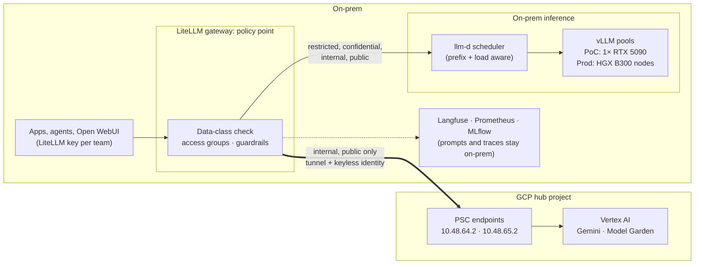

# Hybrid AI Inference — On-Prem and GCP Behind One Gateway

← [GCP hub-and-spoke](README.md) · [Connectivity](hub-connectivity.md) · [Lakehouse](spoke-lakehouse.md) · [Speech and Gemini](hub-ai-services.md) · [Hybrid inference](hybrid-ai-inference.md) · [Live diagram](live-diagram.md)

> **Where this sits:** it spans the on-prem hub and the GCP hub of the
> [GCP hub-and-spoke](README.md). It reuses the tunnel, the PSC endpoints and the keyless identity
> from [Speech and Gemini](hub-ai-services.md), and adds an on-prem inference tier and a placement
> policy in front of both.

Some work can't leave the building: personal data, regulated records, source code, anything under
contract or residency rules. Other work is better served by Gemini on Vertex AI. This design puts
both behind **one gateway** on-prem. The gateway decides where each request may run, from the
data's class, not from the caller's preference. A **benchmark** then tells which model to use
where both are allowed.

**Status:** design. Pieces already running:
- on-prem vLLM serving Qwen3.6-27B on one RTX 5090, with a measured benchmark in
  mini-platform-deployment;
- nine Google models through LiteLLM over the VPN.

The placement policy, egress controls and the hybrid benchmark are the next steps in
[Plan](#plan).

---

## Architecture



The gateway is the only path to either tier. Everything else hangs off that:
- Callers never get an engine URL or a Google credential (in the PoC the namespace still leaks the gateway's identity; see [Egress](#egress-making-the-gateway-the-only-door)).
- The data class travels with the caller's key.
- Each model belongs to a placement group.
- A key only sees the groups its class allows.

---

## Data classes and placement

| Class | Examples | On-prem | GCP | Notes |
|-------|----------|---------|-----|-------|
| **Restricted** | Personal data under special rules, health, credentials, regulated records, customer source code | ✅ only | ❌ | Never routed or failed over to GCP |
| **Confidential** | Internal financials, unreleased product data, contracts | ✅ default | ⚠️ by exception | Exception needs a named owner and Vertex AI's data terms checked for the use case |
| **Internal** | Internal docs, tickets, code of internal tools | ✅ | ✅ | Place by benchmark: quality, latency, cost |
| **Public** | Published content, marketing, public docs | ✅ | ✅ | Usually the cheapest model that passes the quality bar |

Rules that hold in every class:

- **Fail closed, and fail over only inward.** A GCP model may fall back to on-prem; an on-prem model
  never falls back to GCP. When on-prem is saturated, a restricted request queues or fails; it
  never spills over.
- **Residency.** GCP models run in `eu` or `europe-west1` only, as today. That is already enforced
  by the org's location policy plus the hub's `eu` exception.
- **Logs stay on-prem.** LiteLLM stores prompts in its own database
  (`store_prompts_in_spend_logs: true`) and traces in Langfuse, both on-prem. Restricted prompts
  never leave, even as telemetry.

### How the gateway enforces it

All of this is LiteLLM configuration; nothing new to run.

| Mechanism | Setting | Effect |
|-----------|---------|--------|
| **Placement groups** | `model_info.access_groups`: `onprem` on vLLM models, `gcp` on Vertex models | One label per model; new models inherit the policy by group |
| **Keys and teams per class** | A team per data class; its keys may use `onprem` only, or `onprem` + `gcp` | A restricted caller can't even name a Gemini model: 401, not a silent reroute |
| **Fallbacks** | `router_settings.fallbacks` only from `gcp` models to `onprem` models | Cloud outage or quota → on-prem; never the reverse |
| **Guardrail on cloud-bound calls** | A pre-call PII guardrail (for example Presidio) on `gcp`-group models, set to block | Catches restricted data sent on an internal-class key |
| **Aliases** | Models named by role, `chat-default` and `chat-sensitive`, each mapped to concrete models | Apps don't hard-code a model, so placement can change after a benchmark without app changes |

### Egress: making the gateway the only door

Policy in the gateway only counts if nothing can go around it.

| Layer | PoC today | Production |
|-------|-----------|------------|
| **Google identity** | Google accepts only `system:serviceaccount:mini-platform:litellm` (identity-pool condition). But on the Kubernetes side, anything that can create pods in `mini-platform` (Argo CD, JupyterHub's `hub`, the Spark operator) or mint that service account's token (kagent's kmcp controller) can act as it ([who can act as `litellm-stt`](hub-ai-services.md#who-can-act-as-litellm-stt)) | LiteLLM alone in its own namespace, with the condition updated to match; an admission policy that admits `serviceAccountName: litellm` only for the gateway's pods; no role other than the kubelet's can create `serviceaccounts/token` for it |
| **Network to the PSC IPs** | Any pod can reach `10.48.64.2` over the tunnel. Minikube's CNI doesn't enforce NetworkPolicy, and the tunnel host rewrites every source to its LAN address. | NetworkPolicy egress (a policy-enforcing CNI) lets only the gateway reach the PSC IPs; the on-prem NGFW allows only the gateway's source range to the GCP endpoint ranges |
| **Other projects through PSC** | `all-apis` reaches any project's APIs, so a pod holding its own Google credential could use them | A VPC Service Controls perimeter around the hub, with the PSC endpoint on the `vpc-sc` bundle |
| **Internet** | The home router allows it | Default-deny egress (constraint C2); public AI APIs blocked at the NGFW |

So in the PoC the gateway is not yet the only door. A Spark job, a notebook spawned by JupyterHub,
or a compromised kagent controller can obtain the `litellm` token, trade it for the hub's Google
credentials and call Gemini directly: no data-class check, no PII guardrail. Without that token, a
pod that reaches the PSC IP can't call anything. Locking down the gateway identity (plan step 3)
closes the main hole and fits the PoC; the network controls in the right-hand column close the
rest in production.

---

## The two inference tiers

### On-prem

| | PoC (running) | Production |
|---|---|---|
| Hardware | 1× RTX 5090, 32 GB | HGX B300 nodes: Blackwell Ultra, 288 GB HBM3e per GPU, NVLink within a node |
| Model today | `unsloth/Qwen3.6-27B-NVFP4` (≈ 24 GB of weights), 8k context, FP8 KV cache | Large open-weight models (hundreds of billions of parameters, MoE) at FP8 or NVFP4, long context |
| Engine | vLLM, `--enforce-eager` (no room for CUDA graphs at this weight-to-memory ratio) | vLLM with CUDA graphs, tensor and expert parallelism across a node |
| Routing | vLLM production-stack router (llm-d available, off) | llm-d: prefix-cache-aware scheduling, prefill/decode disaggregation, many replicas |
| Measured | 324.8 output tok/s at concurrency 32; TTFT median 145 ms at concurrency 1 ([benchmark][bench]) | To be measured on the target nodes |

The PoC proves the serving stack, the gateway policy and the benchmark harness. **It doesn't predict
B300 numbers.** The PoC card holds one quantized mid-size model with almost no KV-cache room and
runs in eager mode. The earlier router benchmark also showed that llm-d's value only appears with
several replicas, which only the production cluster has. Treat the PoC as a functional and
methodology test, and re-run the same harness on B300 before deciding placements.

### GCP

| Option | What | When |
|--------|------|------|
| **Gemini, managed** (running) | `gemini-4-argon`, `gemini-3.8-flash`, `gemini-3.5-flash`, `gemini-3.5-flash-lite` in `eu` | Default cloud choice for internal and public work |
| **Open-weight, managed** (Model Garden, model-as-a-service) | The same open-weight family as on-prem, as a managed API, if offered in `eu` or `europe-west1` | Lets the benchmark compare one model on two platforms, and gives burst capacity for internal work |
| **Open-weight, self-deployed** | vLLM on a Vertex AI endpoint or GKE with GPUs in the hub, if the model isn't offered as a managed API | Only for a model that must match on-prem exactly and has no managed offer. Check regional GPU availability and quota first; this adds a fixed cost. |

All three use the existing path: tunnel, PSC endpoints, keyless identity. A self-deployed endpoint
also needs its private IP advertised and a DNS entry, like the regional endpoint.

---

## Benchmark: on-prem open-weight vs GCP models

The benchmark answers one question per use case: **which allowed model clears the quality bar at
the lowest cost per request within the latency target?** It measures two things on the same
prompts.

### 1. Performance, through the gateway

Run from an in-cluster pod, like the earlier benchmark, but against the LiteLLM endpoint, so both
tiers carry the same gateway and network overhead.

| Setting | Value |
|---------|-------|
| Tool | `vllm bench serve` (`--backend openai-chat`, `--endpoint /v1/chat/completions`), as in [tools/vllm-bench.yaml][benchpod] |
| Targets | `qwen3.6-27b` (on-prem) · `gemini-3.8-flash`, `gemini-3.5-flash-lite`, `gemini-4-argon` (GCP) · the managed open-weight model, if one is offered |
| Prompts | One fixed set per use case (real, de-identified prompts) plus ShareGPT for a general load profile; `--seed 42`; same `max_tokens` |
| Load | Closed loop at concurrency 1, 8, 32; a warm-up run discarded; three repeats |
| Metrics | TTFT (median and p99), time per output token, output tok/s, error rate including 429s |
| Where | The same pod for every target, so the tunnel and PSC hop count toward GCP's latency |

Fairness rules, because the tiers differ:
- **Tokens aren't comparable across tokenizers.** Report throughput per output token, and also
  per output character or word.
- **Thinking tokens.** Gemini's thinking tokens bill as output. Pin the thinking budget, and
  report billed tokens next to visible ones.
- **Quotas.** A Vertex 429 means quota, not speed. Record it separately, and request quota before
  the high-concurrency runs.
- **Variance.** Cloud latency changes with time of day. Spread the repeats across the day.
- **Hardware.** Results from the 5090 are labelled PoC; only B300 runs feed production placement.

### 2. Quality, per use case

| Step | How |
|------|-----|
| Eval set | 100–300 representative prompts per use case, with reference answers or grading rubrics, kept on-prem as a Langfuse dataset |
| Scoring | Exact or programmatic checks where possible (extraction, classification, code tests). An LLM judge for open-ended answers. **The judge runs on-prem**, so restricted eval data never leaves. |
| Public baselines | A few standard suites through `lm-eval-harness` against the same endpoints, to catch regressions from quantization (NVFP4 vs full precision) |
| Tracking | One MLflow experiment per use case: model, tier, quantization, hardware, scores, latency, cost |

### 3. Cost per request

- **GCP:** list price × billed tokens, from the measured runs. For example, Gemini 3.8 Flash
  costs $0.75 per 1M input tokens and $3.75 per 1M output tokens.
- **On-prem:** a cost per GPU-hour, divided by the tokens served per GPU-hour at a realistic
  utilization:

```
cost per 1M output tokens = (GPU capex per hour + power + hosting + ops per GPU-hour)
                            ÷ (measured output tok/s per GPU × 3600 × utilization) × 1,000,000
```

The cost per GPU-hour comes from finance (amortization period, power price, PUE). Measured
throughput at concurrency 32 is the upper bound. Real utilization is lower, and low utilization is
what usually makes cloud cheaper for spiky internal traffic.

### Output

A placement table per use case, which becomes the alias mapping in the gateway:

| Use case | Class | Quality bar | Allowed | Chosen | Why |
|----------|-------|-------------|---------|--------|-----|
| *e.g. ticket summarization* | internal | ≥ 0.85 rubric score | on-prem, GCP | *from the benchmark* | *cheapest that passes at p99 TTFT < 2 s* |
| *e.g. HR case assistant* | restricted | ≥ 0.9 | on-prem | on-prem only | class decides; the benchmark only picks the on-prem model |

---

## Plan

| Step | Where | Done when |
|------|-------|-----------|
| 1. Placement groups, one team per class, fallbacks only inward | LiteLLM values (mini-platform-deployment) | A restricted key gets 401 on every Gemini model; a GCP outage falls back to `qwen3.6-27b` |
| 2. PII guardrail on `gcp`-group models | LiteLLM values | A test prompt with personal data on an internal key is blocked before leaving |
| 3. Lock down the gateway identity | mini-platform-deployment: own namespace for LiteLLM, admission policy, kmcp role; this repo: the identity-pool condition | A pod created by Spark, JupyterHub or Argo CD with `serviceAccountName: litellm` is rejected at admission; kmcp can't request the token (`kubectl auth can-i` says no); only the gateway's pods get a Google token |
| 4. Hybrid benchmark harness | `tools/` + `docs/benchmarks/` (mini-platform-deployment) | One command runs the performance matrix through the gateway; results in MLflow |
| 5. Eval sets and on-prem judge | Langfuse datasets, MLflow | Quality scores for 2–3 real use cases on the PoC |
| 6. Managed open-weight model on Vertex, if offered in `eu` | LiteLLM values; this repo if a new endpoint is needed | Same model compared on both tiers |
| 7. Production egress controls | Policy-enforcing CNI, NGFW rules, VPC-SC perimeter | Only the gateway reaches the PSC IPs; other projects are unreachable through PSC |
| 8. B300 validation | Production cluster | The same harness re-run on B300; placement table updated from those numbers |

Steps 1–5 fit the PoC: single GPU, no new GCP resources (step 3 only edits the existing identity-pool
condition). Until step 3 is done, the data-class policy can be bypassed from inside the namespace,
so restricted workloads shouldn't rely on it. Step 6 depends on what Model Garden offers in the EU,
and step 7 on production hardware and network.

[bench]: https://github.com/nolimitkun/mini-platform-deployment/blob/main/docs/benchmarks/llm-d-vs-production-stack.md
[benchpod]: https://github.com/nolimitkun/mini-platform-deployment/blob/main/tools/vllm-bench.yaml
